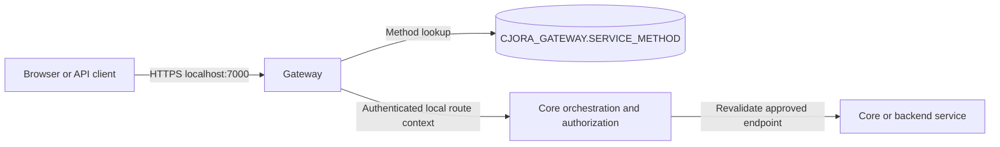

# Gateway-owned method registry and HTTPS

Current ownership: 1 November 2026. SERVICE_METHOD and its lookup belong to Gateway, in CJORA_GATEWAY. Core does not query Gateway tables and no longer has a registry connection. The PSA_DOTNET files remain reference material; their custom encryption and credential forwarding were not copied.

## Request flow



Public dynamic route: `/{service}/{method}` with GET, POST, PUT, PATCH or DELETE. Gateway queries its own database by exact service, method alias and HTTP verb; disabled, untested and missing rows return 404. The request always goes to Core after resolution. Core receives immutable routing metadata, validates the caller, revalidates destination/verb/body constraints and retains workflow and authorization responsibilities. No runtime service reads another service's database.

Existing `/api/v1/**` forwarding still targets only Core. That static proxy strips caller-supplied internal routing headers. Dynamic requests use RegisteredMethodController, which also strips forged headers and supplies its own trusted metadata. The method registry cannot grant a user permission or create arbitrary executable behavior.

METHOD_HOST must match a deployment-approved service origin. METHOD_PATH selects an implemented endpoint and cannot contain traversal, embedded query/fragment or dispatcher loops. Gateway itself is not an approved downstream destination. Active aliases/status changes apply on the next request without source edits; new business behavior still requires an implemented handler and reviewed contract.

## Database ownership and migrations

Gateway owns SERVICE_METHOD, API_LOG, ERROR_LOGS and its independent MIGRATION_HISTORY. Its runtime account has only SELECT on SERVICE_METHOD and INSERT on ERROR_LOGS. Its migrator is a separate account scoped to CJORA_GATEWAY.

Core's current runtime account has only INSERT on its own ERROR_LOGS for this routing prototype. It cannot read Gateway registrations, Core customer data or the historical archive. Core business persistence accounts will be scoped separately when those features are implemented. Lookup failures are recorded in Gateway.ERROR_LOGS; orchestration/forwarding failures are recorded in the responsible service's logs with a shared validated correlation identifier.

Historical Core migration 0003 was already applied, so it was not edited. Core migration 0004 renames that table to SERVICE_METHOD_ARCHIVE and records the archive action in Core.API_LOG. The archive preserves the original rows and audit history and is never read by runtime code. Gateway migrations 0001/0002 create its logs and live registry. An explicit local operator setup imports missing legacy UUIDs/metadata into Gateway with API_LOG records in the same transaction; Gateway-local numeric IDs are independently generated. Existing Gateway registrations are never overwritten on setup replay. A conflicting alias with another UUID fails atomically.

The former Core registry account is revoked/locked, and its old connection setting is removed. Cross-database access exists only in the one-time operator import, not in either API's runtime credentials. A future archive-retention decision can remove the historical archive through another reviewed migration; it was preserved to avoid losing configuration/history.

All table names/columns are uppercase, with numeric ID first, UUID second, documentation comments and creation/update/concurrency metadata. New registrations default disabled, untested, sensitive, Development-only and SESSION-authorized. METHOD_HOST is origin-only, with METHOD_PATH separate; legacy zero dates and METHOD_ID naming were not copied.

## Caller validation and authorization boundary

For local Development, Gateway and Core share an independent random 256-bit workload credential in their own User Secrets. Core compares it in constant time and accepts it only from loopback; metadata is bounded and validated. Browser-supplied route credentials are removed/replaced. Core strips the internal credential/metadata before calling a backend. This is workload caller validation, not customer authentication and not payload encryption.

This temporary local bridge is never accepted in Production: dynamic dispatch returns 503 until production workload identity is implemented. Production requires authenticated private TLS with a proper workload identity mechanism such as mTLS or scoped service tokens. Do not deploy the local loopback/shared-credential profile as a production trust boundary.

Both Gateway and Core restrict PUBLIC_DIAGNOSTIC to health and explicit Development transport checks. SESSION methods fail closed until linked-session authorization exists; a database flag cannot expose arbitrary profile/payment endpoints anonymously. There is no public registration-write API.

Current registrations:

| Public request | Implemented endpoint | Scope |
| --- | --- | --- |
| GET /core/health | Core /health/live | Process liveness |
| POST /core/echo | Core /api/v1/cor/diagnostics/echo | Development JSON transport check |
| POST /documents/upload-check | Documents /api/v1/doc/diagnostics/upload | Development multipart transport check |

Every administrative route change must compare ROW_VERSION, validate the implemented contract/destination and commit an API_LOG change in Gateway's local transaction. Direct unaudited SQL edits are not the administration workflow.

## JSON, multipart, HTTPS and limits

Bodies are not deserialized/rebuilt by the proxy. MVC form providers are removed before forwarding. Known-length uploads stream through; unknown-length bodies receive bounded temporary preflight buffering in Core and are rewound. Temporary buffers are disposed automatically. Multiple files, binary bytes and repeated form fields are preserved. Diagnostic upload only reports lengths/hashes and never publishes/saves business documents; real uploads still need ownership checks, quarantine, scanning, private storage and retention.

Gateway uses https://localhost:7000 and redirects HTTP dynamic/versioned requests. Development-only process diagnostics/Swagger/weather remain available on loopback HTTP 5080. Production enables HSTS and redirects all ingress HTTP; the local internal HTTP bridge is not a deployed service-network security configuration. Use `dotnet dev-certs https --trust` locally if needed, reviewing the OS prompt. Tests export only the public development certificate and use curl --cacert; they never disable certificate validation or export private keys.

Per-instance rate limit: 120 requests/minute per observed peer IP, no queue, 429 with Retry-After. Global body ceiling: 10 MiB; demo JSON: 64 KiB; demo multipart: 1 MiB. Forwarding timeouts are bounded to 500-30000 ms; no automatic POST retry. Redirecting downstream destinations are rejected. Browser credentials and forged identity headers are not blindly forwarded by diagnostic dispatch. Sensitive bodies, tokens and full forwarding URLs are not logged.

Safe errors persist independently in each service's ERROR_LOGS. If its own database is unavailable, sanitized records are flushed to ignored .local/errors/routing-errors.jsonl under that API. Replay/retention and deployed durable storage still require implementation. Ordinary successful health reads do not create business audits.

## Local setup and checks

Start the local MySQL container, then run:

```powershell
./SCRIPTS/Initialize-GatewayDatabase.ps1
```

This applies Core's archive migration, creates Gateway's independent database/accounts/migrations, imports the legacy registrations with audits, and configures separate runtime connections plus the local bridge credential. Passwords enter processes through environment/stdin and stay in ignored .env/User Secrets. User Secrets are unencrypted local storage. Local MySQL connections use loopback SslMode=Disabled; remote deployment needs verified TLS and a secret manager.

Run these in separate terminals:

```powershell
dotnet run --project SRC/CORE/CJora.Core.Api --launch-profile http
dotnet run --project SRC/GATEWAY/CJora.Gateway.Api --launch-profile https
dotnet run --project SRC/DOCUMENTS/CJora.Documents.Api --launch-profile http
```

Examples:

```powershell
$certificate = ./SCRIPTS/Export-DevelopmentCertificate.ps1
curl.exe --cacert $certificate https://localhost:7000/core/health
curl.exe --cacert $certificate -H "Content-Type: application/json" --data-binary '@request.json' https://localhost:7000/core/echo
curl.exe --cacert $certificate -F 'file=@sample.pdf' -F 'note=fictional-test' https://localhost:7000/documents/upload-check
```

Use fictional data in Development transport checks.

Validated: 133 unit tests across nine projects; zero build warnings/errors. All eight service smoke checks and live HTTPS JSON/multipart/rate-limit checks pass. Forged metadata is rejected through Gateway's versioned path and directly at Core. Both fixed-length and chunked upload overruns are denied. Temporary Gateway-only registrations demonstrate dynamic enable/disable and destination/session-policy refusal, with audited cleanup. Three legacy registrations have three target import audits; Core has no live SERVICE_METHOD table. MySQL privileges deny Gateway route updates/Core table reads and deny Core reads of Gateway or its legacy archive. Setup/migration replay is a no-op for registrations and history.

These are scoped checks, not a formal penetration test or production readiness approval. Keycloak login, linked-session/Program/resource authorization, production workload identity/TLS, CSRF/cookie controls, change approval, operational recovery and real document scanning/storage remain unfinished.

References: https://cheatsheetseries.owasp.org/cheatsheets/REST_Security_Cheat_Sheet.html ; https://cheatsheetseries.owasp.org/cheatsheets/Cryptographic_Storage_Cheat_Sheet.html ; https://wstg.owasp.org/ .